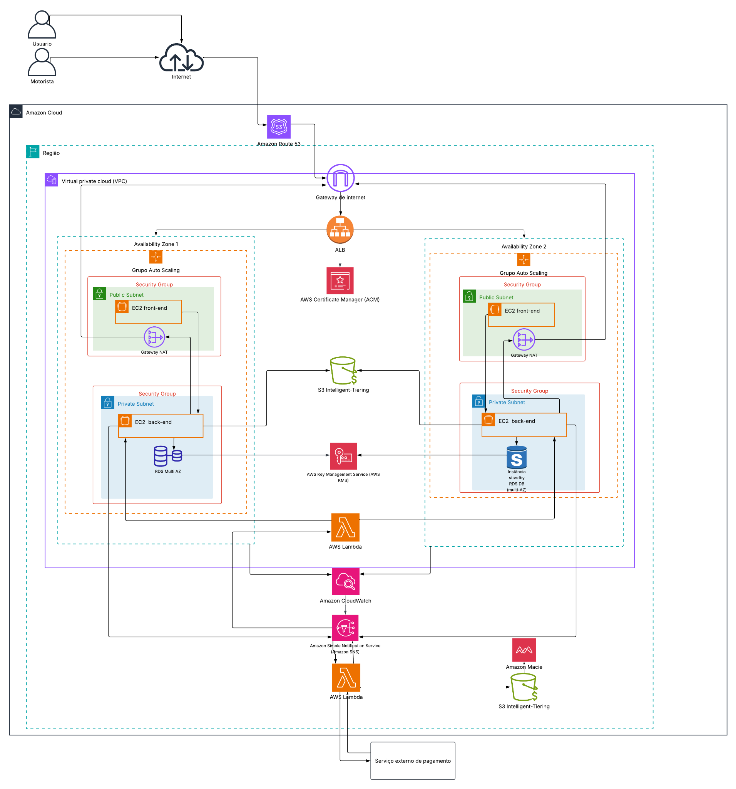

# RotaFácil — Mobilidade Inteligente

> **Projeto de conclusão do programa Generation Brasil — AWS re/Start Graduate**  
> Case 1: plataforma de transporte por aplicativo para mobilidade urbana.

## Sobre o projeto

O **RotaFácil** é uma proposta de plataforma de mobilidade urbana que conecta passageiros a motoristas parceiros para corridas urbanas, com acompanhamento da localização em tempo real e cálculo de tarifa dinâmica.

Este projeto foi desenvolvido como parte do desafio de conclusão do curso **AWS re/Start — Graduate**. O trabalho analisa os problemas de uma arquitetura legada e apresenta uma proposta de modernização utilizando serviços da Amazon Web Services (AWS), considerando disponibilidade, escalabilidade, segurança, monitoramento e otimização de custos.

## Regras de negócio

### Funcionais

- O passageiro solicita uma corrida e recebe o motorista disponível mais próximo em poucos segundos.
- A localização do motorista é atualizada continuamente durante a corrida.
- A tarifa varia conforme a demanda do momento, podendo aumentar em horários de pico.
- Passageiro e motorista avaliam um ao outro ao final da corrida.
- O pagamento é processado por uma integração com um gateway de pagamento externo.

### Não funcionais

- A plataforma precisa lidar com variações de demanda ao longo do dia, especialmente em horários de pico e finais de semana.
- A atualização da localização exige resposta rápida para evitar prejuízo à experiência do usuário.
- O aplicativo não pode ficar indisponível durante uma corrida em andamento.
- Dados de localização e pagamento são sensíveis e precisam de proteção adequada, considerando a LGPD.

## Problemas identificados na arquitetura atual

O desafio descreve uma arquitetura legada com capacidade fixa, aplicação monolítica e poucos mecanismos de resiliência. Os principais problemas são:

### 1. Capacidade fixa e falta de distribuição automática de carga

- Servidores físicos hospedados em um datacenter alugado, com capacidade contratada fixa.
- Aplicação única (monolítica) rodando em poucos servidores, sem distribuição automática de carga.
- Aumento de demanda em horários de pico pode sobrecarregar os servidores.
- A falha de um servidor pode afetar o acesso à aplicação e a experiência dos usuários.

### 2. Banco de dados sem redundância e arquivos locais

- Um único banco de dados relacional, sem cópia de segurança em outro local, representando um ponto único de falha.
- Fotos de perfil e documentos dos motoristas ficam salvos nos discos locais dos próprios servidores.
- Uma falha de servidor ou de armazenamento pode interromper o acesso a arquivos e dificultar a recuperação de dados.
- Arquivos locais dificultam o compartilhamento e a expansão da aplicação entre várias instâncias.

### 3. Ausência de monitoramento automatizado

- Não existe monitoramento automatizado descrito no cenário legado.
- A equipe só descobre uma queda quando um usuário reclama.
- A detecção tardia pode aumentar o tempo de resposta e o impacto da indisponibilidade.

## Arquitetura AWS proposta

A arquitetura proposta utiliza recursos da AWS distribuídos em duas zonas de disponibilidade, com segmentação de rede pública e privada, distribuição de tráfego, banco de dados com implantação Multi-AZ, armazenamento de objetos e serviços de monitoramento e segurança.

### Componentes e justificativa

| Serviço/componente | Função na proposta | Problema que ajuda a tratar |
|---|---|---|
| **Amazon Route 53** | Resolução DNS para encaminhar o domínio ao endpoint configurado. | Organiza o acesso à aplicação por nome de domínio. |
| **Amazon VPC e sub-redes públicas/privadas** | Organizam e segmentam a rede da aplicação. | Permitem separar recursos expostos dos componentes internos e controlar o tráfego. |
| **Internet Gateway** | Permite conectividade entre a VPC e a internet conforme as rotas configuradas. | Viabiliza o acesso externo aos recursos que precisam dele. |
| **NAT Gateway** | Permite que recursos em sub-redes privadas iniciem conexões de saída, conforme a configuração. | Evita a necessidade de expor diretamente instâncias privadas à internet para esse tipo de acesso. |
| **Amazon EC2 — front-end** | Hospeda a camada de apresentação da aplicação. | Separa a camada visual dos componentes de processamento. |
| **Amazon EC2 — back-end** | Processa solicitações e comunica-se com os serviços autorizados. | Organiza a camada de processamento da aplicação. |
| **Application Load Balancer (ALB)** | Distribui requisições entre os destinos configurados. | Reduz a concentração de tráfego em uma única instância. |
| **Auto Scaling** | Ajusta a quantidade de instâncias conforme políticas e métricas configuradas. | Ajuda a lidar com variações de demanda e horários de pico. |
| **Duas zonas de disponibilidade** | Distribuem recursos entre Availability Zones. | Ajudam a reduzir a dependência de uma única zona, conforme a implantação. |
| **Amazon RDS Multi-AZ** | Banco de dados relacional com instância principal e standby, conforme configuração. | Melhora a disponibilidade do banco de dados diante de determinadas falhas. |
| **Backups do banco de dados** | Cópias de segurança para recuperação. | Ajudam a recuperar dados em caso de exclusão, corrupção ou falha. |
| **Amazon S3** | Armazena objetos, como fotos e documentos, de forma centralizada. | Reduz a dependência de arquivos guardados apenas nos discos das instâncias EC2. |
| **S3 Intelligent-Tiering** | Pode otimizar custos de armazenamento conforme os padrões de acesso. | Ajuda na gestão de custos quando o padrão de acesso é adequado. |
| **AWS Lambda** | Executa funções sob demanda para tarefas definidas na solução. | Permite automatizar tarefas sem manter um servidor dedicado para cada função. |
| **Amazon CloudWatch** | Coleta métricas e logs e permite configurar alarmes. | Ajuda a detectar anomalias e falhas com maior antecedência. |
| **Amazon SNS** | Distribui notificações para assinantes configurados. | Apoia o envio de alertas para a equipe ou outros componentes. |
| **AWS KMS** | Gerencia chaves criptográficas. | Apoia a proteção de dados por criptografia quando integrado aos serviços pertinentes. |
| **Amazon Macie** | Identifica possíveis dados sensíveis em fontes compatíveis, como o S3. | Apoia a identificação e proteção de dados sensíveis armazenados. |
| **AWS Certificate Manager (ACM)** | Gerencia certificados TLS/SSL para serviços integrados compatíveis. | Apoia conexões criptografadas nos endpoints compatíveis. |
| **Grupos de segurança** | Controlam o tráfego de entrada e saída dos recursos associados. | Restringem a comunicação aos acessos permitidos. |
| **Gateway de pagamento externo** | Integração de pagamento indicada no desafio. | Representa o processamento por provedor externo; o fornecedor não foi especificado. |

> **Nota técnica:** esta documentação descreve a arquitetura proposta no material do desafio. A presença de um serviço no diagrama não comprova que ele já esteja implantado ou configurado em produção. Os benefícios dependem das configurações, das políticas de segurança e dos testes realizados.

## Como a arquitetura responde aos problemas

### Distribuição de carga e escalabilidade

O **Application Load Balancer** distribui o tráfego entre os destinos configurados. O **Auto Scaling** permite ajustar a quantidade de instâncias de acordo com políticas e métricas definidas. Em conjunto, esses recursos podem ajudar a lidar com o aumento de solicitações em horários de pico.

### Disponibilidade e recuperação de dados

O **Amazon RDS Multi-AZ** mantém uma implantação standby em outra zona de disponibilidade, conforme a configuração do serviço, e pode apoiar a continuidade do banco de dados diante de determinadas falhas. Os backups são necessários como mecanismo complementar de recuperação: alta disponibilidade e backup não são a mesma coisa.

### Armazenamento de fotos e documentos

O **Amazon S3** permite centralizar fotos de perfil e documentos, reduzindo a dependência dos discos locais das instâncias EC2. As permissões, políticas de acesso e opções de proteção devem ser configuradas de acordo com os requisitos do projeto.

### Monitoramento e alertas

O **Amazon CloudWatch** pode acompanhar métricas e logs e disparar alarmes. O **Amazon SNS** pode distribuir notificações para assinantes configurados; funções **AWS Lambda** podem executar ações automatizadas quando integradas ao fluxo definido.

### Segurança e proteção de dados

A segmentação de rede, os grupos de segurança, o gerenciamento de chaves pelo **AWS KMS**, a análise de dados sensíveis com **Amazon Macie** e o uso de certificados TLS/SSL por serviços compatíveis contribuem para uma estratégia de segurança em camadas. A conformidade com a LGPD exige também decisões sobre coleta, finalidade, retenção, acesso e tratamento dos dados — não depende apenas dos serviços de nuvem.

## Fluxo geral da arquitetura

1. Passageiros e motoristas acessam a plataforma pela internet.
2. O Amazon Route 53 resolve o domínio, quando configurado.
3. O tráfego chega ao ponto de entrada da aplicação e ao Application Load Balancer.
4. O balanceador encaminha as requisições aos destinos configurados nas zonas de disponibilidade.
5. O back-end comunica-se com o banco de dados e com os serviços auxiliares autorizados.
6. O Amazon S3 pode armazenar fotos e documentos.
7. O CloudWatch acompanha métricas e logs; alarmes podem acionar notificações pelo SNS e funções Lambda, conforme as integrações configuradas.
8. O pagamento é encaminhado à integração com gateway externo prevista no desafio.

Este fluxo é uma explicação conceitual do diagrama, não uma especificação de funcionalidades já implementadas.

## Tecnologias e serviços

- Amazon Web Services (AWS)
- Amazon EC2
- Amazon VPC e sub-redes
- Application Load Balancer (ALB)
- Auto Scaling
- Amazon RDS Multi-AZ
- Amazon S3 e S3 Intelligent-Tiering
- AWS Lambda
- Amazon CloudWatch
- Amazon SNS
- AWS KMS
- Amazon Macie
- Amazon Route 53
- AWS Certificate Manager (ACM)
- Git e GitHub para versionamento e documentação

As linguagens de programação, frameworks e o fornecedor do gateway de pagamento não foram especificados no material fornecido e, por isso, não são presumidos neste documento.

## Equipe do projeto

- **Richardson Firmino**
- **Erica Claudiano**
- **Monica Ribeiro**
- **Kauã Muniz**
- **Ana Verduguez**
- **Guilherme Moreira**
- **Vitor Nazareth**

## Conclusão

O desafio do RotaFácil permitiu analisar limitações de uma arquitetura legada e propor uma infraestrutura em nuvem com foco em distribuição de carga, escalabilidade, disponibilidade, armazenamento centralizado, monitoramento e segurança.

A proposta combina serviços gerenciados e recursos de computação da AWS para responder aos problemas apresentados no case. A efetividade da solução deve ser validada por meio de implementação, testes de carga, testes de recuperação, revisão das configurações de segurança e avaliação de custos.

## Formação e contexto do projeto

Este trabalho foi desenvolvido como **desafio de conclusão do programa Generation Brasil**, no contexto do curso **AWS re/Start — Graduate**. O projeto aplica conceitos de computação em nuvem e arquitetura AWS em um estudo de caso de mobilidade urbana.

## Status do projeto

Projeto acadêmico de arquitetura e documentação. Atualize esta seção caso os recursos sejam implantados e testados.

## Licença

A licença ainda não foi definida. A equipe deve decidir os termos de reutilização do código e dos materiais antes de adicionar um arquivo de licença.
